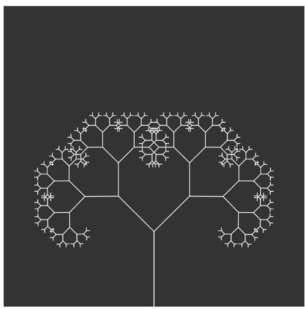

# Fractal Trees

One recursive function that draws a whole tree, branch by branch.

Drag the slider to change the angle between branches.

[Run it live](https://matheusmota-dev-br.github.io/p5js-code-challenge/sketches/fractal-trees/) · [Coding Challenge #14](https://thecodingtrain.com/challenges/14-fractal-trees-recursive)

