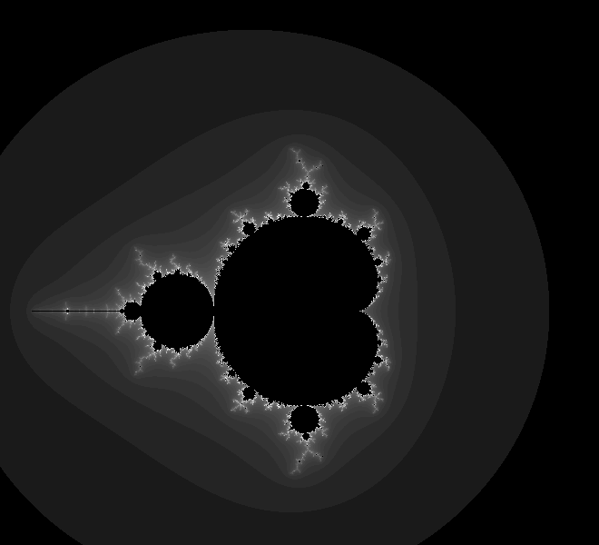

# Mandelbrot Set

Every pixel is a complex number, shaded by how fast it escapes to infinity.

A still image, computed pixel by pixel in your browser.

[Run it live](https://matheusmota-dev-br.github.io/p5js-code-challenge/sketches/mandelbrot/) · [Coding Challenge #21](https://thecodingtrain.com/challenges/21-mandelbrot-set-with-p5js)

