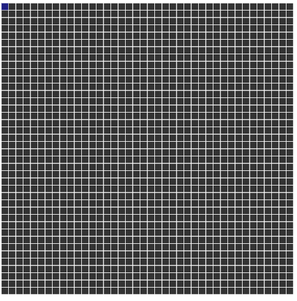

# Maze Generation

Depth-first search with backtracking, carving a maze one cell at a time.

Click the canvas to generate a new maze.

[Run it live](https://matheusmota-dev-br.github.io/p5js-code-challenge/sketches/maze-generation/) · [Coding Challenge #10](https://thecodingtrain.com/challenges/10-dfs-maze-generator)

