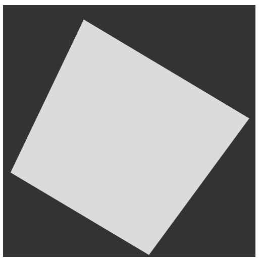

# Menger Sponge

A cube that keeps being carved into smaller cubes, up to 8,000 of them.

Click the canvas to subdivide. After the third level it starts over.

[Run it live](https://matheusmota-dev-br.github.io/p5js-code-challenge/sketches/menger-sponge/) · [Coding Challenge #2](https://thecodingtrain.com/challenges/2-menger-sponge)

