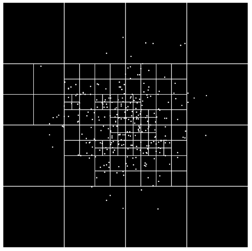

# Quadtree

A tree that splits space into quadrants so nearby points are fast to find.

Move the pointer to query the points inside the green square.

[Run it live](https://matheusmota-dev-br.github.io/p5js-code-challenge/sketches/quadtree/) · [Coding Challenge #98](https://thecodingtrain.com/challenges/98-quadtree)

