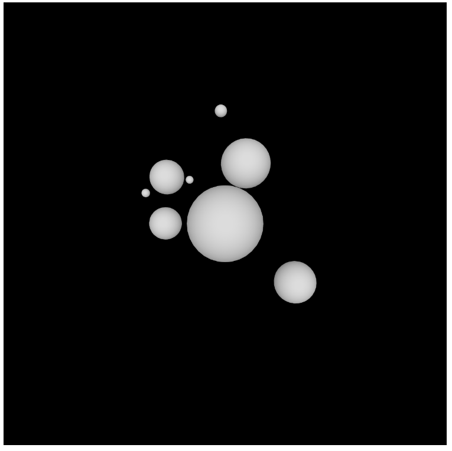

# Solar System

Randomly generated planets, each with its own moons, orbiting in 3D.

Drag to orbit and scroll to zoom.

[Run it live](https://matheusmota-dev-br.github.io/p5js-code-challenge/sketches/solar-system/) · [Coding Challenge #8](https://thecodingtrain.com/challenges/8-solar-system-3d)

